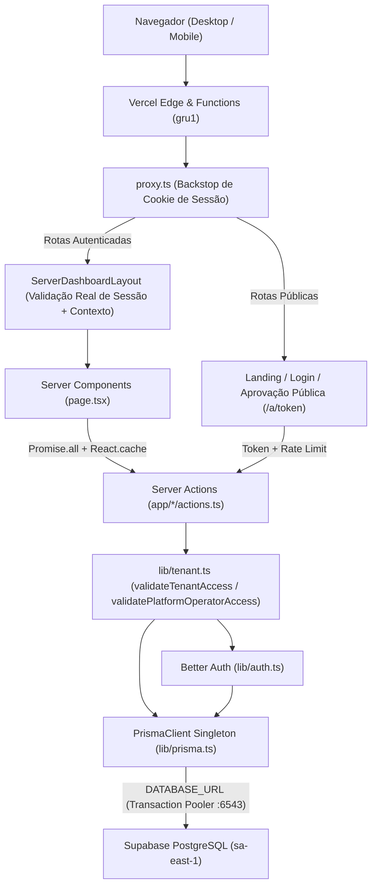

# Arquitetura e Segurança — NV Hub

> **Última atualização:** 18/11/2026  
> **Documentos relacionados:** [Escopo do Projeto](./project-scope.md) · [Matriz de Desenvolvimento e QA](./status-and-qa-matrix.md) · [Banco de Dados](./database.md) · [Guia de Desenvolvimento](./development-guide.md)

---

## 1. Stack Tecnológica

| Camada | Tecnologia | Versão no projeto | Papel |
| --- | --- | --- | --- |
| **Framework Web** | Next.js (App Router) | `16.2.9` | Server Components, Server Actions, `proxy.ts`, roteamento dinâmico |
| **UI / Runtime** | React + TypeScript | `19.2.4` / `5.x` | Interfaces interativas e tipagem estrita |
| **Estilização** | Tailwind CSS + lucide-react | `4.x` / `1.17.0` | Tokens semânticos em `app/globals.css`, responsividade (`app/mobile.css`) e ícones |
| **Autenticação & Tenancy** | Better Auth (`organization` plugin) | `1.6.23` | Sessões em banco, e-mail/senha, organizações e membros |
| **ORM & Banco** | Prisma + PostgreSQL (Supabase) | `6.19.3` | Modelagem relacional, migrations e queries tipadas |
| **Estado Sandbox (Demo)** | Zustand (`persist`) | `5.0.14` | Exclusivo para modo `sandbox` e módulos ainda em protótipo |
| **Hospedagem** | Vercel (`gru1` — São Paulo) | — | Hosting serverless alinhado à região do banco (`sa-east-1`) |

---

## 2. Visão Geral da Arquitetura



### Convenções específicas do Next.js 16 adotadas
- **`proxy.ts` (sucessor de `middleware.ts`):** atua como primeira barreira leve de sessão nas rotas privadas (ver Seção 5).
- **`experimental.authInterrupts: true` em `next.config.ts`:** permite invocar `forbidden()` em `app/empresas/layout.tsx`, renderizando automaticamente `app/forbidden.tsx` (HTTP 403).
- **`export const dynamic = 'force-dynamic'`:** aplicado em `app/dashboard/layout.tsx` e nos layouts dos módulos autenticados para garantir leitura sempre atual da sessão e dos dados do tenant, evitando cache cross-tenant.
- **`next dev --webpack`:** configurado em `package.json` para o servidor local de desenvolvimento.

---

## 3. Modo de Dados Fail-Closed (`lib/data-mode.ts`)

O NV Hub suporta dois modos de dados com resolução estritamente **fail-closed**:

| Modo | Como é ativado | Comportamento |
| --- | --- | --- |
| **`database` (padrão)** | Qualquer ambiente sem opt-in explícito, e **sempre** em produção/Vercel (`NODE_ENV === 'production'`, `VERCEL === '1'` ou hostname diferente de `localhost`). | Usa PostgreSQL/Supabase via Prisma e autenticação real via Better Auth. |
| **`sandbox` (demo)** | Apenas com `NEXT_PUBLIC_DATA_MODE="sandbox"` **e** fora de produção. | Usa sessão mockada (`Ana Silva` / `operator`) e store Zustand persistido em `localStorage`. |

Essa regra elimina o risco de uma variável ausente ou deploy mal configurado cair silenciosamente para sessão mockada em produção.

---

## 4. Autenticação, Multi-Tenancy e Contexto por Request

### 4.1 Fluxo de sessão e resolução de tenant (`lib/tenant.ts`)
Todas as funções críticas de sessão e tenant são envoltas em `React.cache()` para **memoização por request**, evitando repetir consultas ao banco durante uma mesma renderização de layout + página + Server Actions:

- `getSession()`: consulta `auth.api.getSession({ headers })` no Better Auth e tenta auto-resolver `activeOrganizationId` se ainda não estiver preenchido na sessão.
- `getOrResolveActiveOrganizationId(session)`: valida que a organização ativa da sessão existe, não está arquivada (`archivedAt === null`) e está ativa (`isActive === true`); caso contrário, resolve automaticamente a partir dos vínculos (`Member`) ou organizações disponíveis para operador.
- `validateTenantAccess(organizationId)`: garante que o usuário autenticado é membro real (`Member`) da organização ativa **ou** um operador de plataforma (`platformRole` = `'operator'` | `'platform_admin'`). Quando acessado por operador sem vínculo de membro, retorna `viaOperatorBypass: true` para marcação no `AuditLog`.
- `isOperator()` e `validatePlatformOperatorAccess()`: helpers dedicados a ações legitimamente cross-tenant (painel `/empresas`), separados do acesso normal de tenant.
- `getCurrentDatabaseTenantContext()` (`lib/tenant-context-actions.ts`): carrega organização ativa, `OrganizationFeature`, papel do membro, `platformRole`, nome do usuário e flag `mustChangePassword` em uma única resolução cacheada, hidratando o `DatabaseTenantProvider` no `DashboardClientLayout` sem waterfalls no cliente.

### 4.2 Fluxo de entrada em rotas autenticadas
1. **`proxy.ts`** verifica a presença do cookie de sessão do Better Auth. Se ausente, redireciona para `/login?redirect=<pathname>`.
2. **`ServerDashboardLayout` (`app/dashboard/layout.tsx`)** — reutilizado pelos layouts de todos os módulos internos — valida a sessão real no servidor via `getSession()` e carrega `getCurrentDatabaseTenantContext()`.
   - Sem sessão válida → `redirect('/login')`.
   - `mustChangePassword === true` → `redirect('/primeiro-acesso')`.
3. **`EmpresasLayout` (`app/empresas/layout.tsx`)** adiciona verificação extra via `isOperator()`; se falso, dispara `forbidden()` (`app/forbidden.tsx`).
4. **Server Components (`page.tsx`)** carregam os dados iniciais do módulo em paralelo com `Promise.all(...)` e entregam como props prontas ao componente cliente.

---

## 5. Mapa de Rotas

### Rotas Públicas (liberadas no `proxy.ts`)
| Rota | Finalidade | Mecanismo de proteção |
| --- | --- | --- |
| `/` | Landing page institucional | Pública |
| `/login` | Autenticação de usuários | Pública |
| `/api/auth/[...better-auth]` | Endpoints REST do Better Auth | `trustedOrigins` + cookies assinados (`BETTER_AUTH_SECRET`) |
| `/a/[token]` e `/publicacao/[id]/aprovacao` | Aprovação pública de publicação pelo cliente externo | Token criptográfico não previsível (`approval_<ts>_<12chars>`), DTO restrito (`PUBLIC_APPROVAL_SELECT`) e rate limit por IP |
| `/proposta/[id]` | Visualização/aceite público de proposta *(ainda mock/Zustand)* | Pendente de migração para token público + DB + rate limit |

### Rotas Autenticadas (Tenant)
- `/primeiro-acesso` — troca obrigatória de senha inicial (`mustChangePassword`)
- `/dashboard` — visão geral do tenant
- `/leads`, `/clientes`, `/clientes/[id]`, `/propostas`, `/contratos`, `/cobrancas` — grupo Comercial
- `/onboarding`, `/publicacoes`, `/tarefas`, `/historico` — grupo Operações
- `/financeiro`, `/configuracoes` — grupo Gestão

### Rotas de Administração da Plataforma (Operador)
- `/empresas` — gestão multi-tenant de organizações, planos, feature flags, usuários e simulação de tenant (`operator` / `platform_admin`).

---

## 6. Camadas de Segurança

1. **Defesa em profundidade de autenticação:** `proxy.ts` impede que uma rota nova sem layout fique exposta sem cookie; layouts e Server Actions sempre revalidam sessão e pertencimento ao tenant no banco.
2. **Isolamento estrito de tenant:** todas as queries e mutações autenticadas filtram por `organizationId` resolvido no servidor — nunca confiam em `organizationId` recebido do cliente. Em atualizações/exclusões por `id`, verifica-se explicitamente `registro.organizationId === activeOrgId`.
3. **Minimização de dados em rotas públicas (DTO dedicado):** `getPublicationByApprovalToken` utiliza `select: PUBLIC_APPROVAL_SELECT` e mapeia para `PublicApprovalPublication`, garantindo que campos internos (`organizationId`, `clientId`, `clientName`, `responsibleUser`, `imageFileName`, `imageMimeType`, `imageSize`, `archivedBy`, `imageSource`) jamais trafeguem para o navegador do cliente externo.
4. **Rate limiting (`lib/rate-limit.ts`):** janela fixa em memória por IP (`x-forwarded-for` / `x-real-ip`), aplicada na aprovação pública:
   - Leitura (`getPublicationByApprovalToken`): **60 req/min por IP**.
   - Mutações (`approvePublicationByTokenAction`, `requestPublicationChangesByTokenAction`): **10 req/min por IP**.
   - *Limitação conhecida:* estado em memória por instância serverless (best-effort). Para limite distribuído global, trocar o backend de `lib/rate-limit.ts` por Upstash/Redis preservando a assinatura `checkRateLimit`.
5. **Trilha de auditoria (`AuditLog`):** registra ações sensíveis com `organizationId`, `userId`, `action` e `target`:
   - Ações via simulação de operador recebem prefixo `[SIMULACAO_OPERADOR]` (implementado em `publicacoes`, pendente de replicar em `clientes` e `tarefas`).
   - Ações públicas de cliente externo recebem prefixo `[CLIENTE_EXTERNO/LINK_PUBLICO]` e são ancoradas no responsável da publicação (fallback: primeiro membro do tenant).

---

## 7. Padrão Arquitetural de Módulos (Referência: `/publicacoes`)

Os módulos migrados para produção devem seguir o padrão consolidado em `app/publicacoes/`:

```text
app/<modulo>/
├── layout.tsx               # Reexporta ServerDashboardLayout com force-dynamic
├── loading.tsx              # Skeleton de carregamento do módulo
├── page.tsx                 # Server Component: decide database vs sandbox e busca dados com Promise.all
├── actions.ts               # Server Actions ('use server') com validação de tenant, feature flag e AuditLog
├── <Modulo>View.tsx         # Componente apresentacional puro (sem Zustand)
├── <Modulo>PageClient.tsx   # Camada interativa em modo database (sem import de lib/store.ts)
└── <Modulo>SandboxClient.tsx # Camada demo opcional com Zustand (carregada apenas fora de produção)
```

Esse desenho elimina waterfalls client-side, remove o flash de estado vazio e impede que o bundle de produção carregue `lib/store.ts`.

---

## 8. Infraestrutura e Observabilidade

- **Região de execução:** `vercel.json` fixa `"regions": ["gru1"]` (São Paulo), mantendo as Functions na mesma região do Supabase (`sa-east-1`) e reduzindo a latência de rede de ~240 ms para ~47–49 ms em conexões aquecidas (ver [supabase-migration-2026-09-29.md](./supabase-migration-2026-09-29.md)).
- **Isolamento de deploy:** `.vercelignore` exclui `.env*` e `backups/` para impedir vazamento de variáveis locais ou dumps durante deploys via CLI.
- **Observabilidade (`lib/performance.ts`):** `measureServerTiming(name, operation, metadata)` registra logs JSON estruturados (`event: "nvhub.performance"`) com `durationMs` e `status`. Ativo automaticamente fora de produção e sob demanda em produção/preview via `PERF_LOGGING="1"`.
