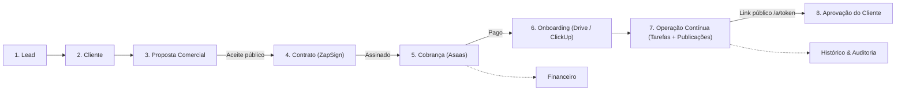

# Escopo do Projeto — NV Hub

> **Produto:** NV Hub (`nvhub.com.br` / `nvhub.vercel.app`)  
> **Categoria:** Plataforma SaaS B2B Multi-Tenant de Gestão Comercial e Operacional  
> **Público-alvo:** Agências digitais, consultorias e empresas de serviços recorrentes  
> **Última atualização:** 18/11/2026  
> **Documentos relacionados:** [Matriz de Desenvolvimento e QA](./status-and-qa-matrix.md) · [Arquitetura](./architecture.md) · [Banco de Dados](./database.md)

---

## 1. Visão Geral e Proposta de Valor

O **NV Hub** centraliza, em uma única plataforma multi-tenant, o ciclo completo de uma agência ou consultoria de serviços recorrentes: da entrada do lead e envio da proposta comercial até a formalização contratual, faturamento, onboarding operacional, gestão de tarefas e aprovação de publicações pelo cliente final.

### Problemas que o produto resolve
- **Operação fragmentada:** dados comerciais, financeiros, entregas e aprovações espalhados entre planilhas, WhatsApp, ferramentas de tarefa e links soltos.
- **Fricção na aprovação de conteúdo:** idas e vindas desorganizadas com clientes finais para aprovar artes, carrosséis e legendas, sem histórico centralizado de revisões.
- **Falta de governança multi-empresa:** dificuldade para operar múltiplos clientes/organizações com isolamento de dados, controle de módulos contratados e trilha de auditoria.

### Estado atual de entrega (resumo executivo)
O projeto encontra-se em evolução incremental orientada a produção:
- **Entregue e 100% funcional em produção:** módulo de **Agendamento de Publicações e Envio para Aprovação do Cliente** (`/publicacoes` e links públicos `/a/[token]`).
- **Em validação / homologação (base de produção construída):** Autenticação e Primeiro Acesso, Administração de Empresas (Operador), Clientes, Tarefas/Planner e Dashboard.
- **Especificado e prototipado (próximas fases de backend e integrações):** Leads, Propostas Comerciais, Contratos (ZapSign), Cobranças (Asaas), Onboarding automatizado (Google Drive / ClickUp), Financeiro, Histórico consolidado e Configurações de Integrações.

Para acompanhar o status técnico detalhado, pendências de código e checklists de teste de cada funcionalidade, consulte a [Matriz de Desenvolvimento, Pendências e QA](./status-and-qa-matrix.md).

---

## 2. Perfis de Usuário, Papéis e Planos

### 2.1 Perfis e níveis de acesso

| Nível | Papel | Escopo | Responsabilidades principais |
| --- | --- | --- | --- |
| **Plataforma** | `platform_admin` / `operator` | Cross-tenant | Gerencia empresas (tenants) em `/empresas`, ativa/desativa planos e feature flags, cria e reseta acessos de usuários e realiza acesso de suporte/simulação auditado em tenants. |
| **Organização (Tenant)** | `owner` | Organização ativa | Controle total do workspace: dados, módulos habilitados, equipe, configurações e operação. |
| **Organização (Tenant)** | `admin` | Organização ativa | Gestão operacional e comercial ampla dentro do tenant, incluindo gestão de clientes, equipe e configurações operacionais. |
| **Organização (Tenant)** | `member` | Organização ativa | Execução diária: gestão de clientes atribuídos, tarefas, publicações e rotinas comerciais/operacionais. |
| **Organização (Tenant)** | `viewer` | Organização ativa | Acesso somente leitura aos módulos liberados para acompanhamento sem permissão de alteração. |
| **Externo (Sem login)** | Cliente final | Registro específico via token | Acessa exclusivamente páginas públicas dedicadas (ex.: aprovação de publicação via `/a/[token]` e, futuramente, aceite de proposta em `/proposta/[id]`), sem exposição de dados internos do tenant. |

### 2.2 Planos e controle de módulos (`OrganizationFeature`)

Cada organização possui um plano (`starter`, `pro` ou `enterprise`) e um conjunto individual de *feature flags* que podem ser ligadas ou desligadas pelo operador da plataforma.

| Módulo / Flag | `starter` (padrão) | `pro` (padrão) | `enterprise` (padrão) |
| --- | :---: | :---: | :---: |
| Leads (`leads`) | Sim | Sim | Sim |
| Clientes (`clients`) | Sim | Sim | Sim |
| Propostas (`proposals`) + Proposta Pública | Sim | Sim | Sim |
| Tarefas & Planner (`tasks`) | Sim | Sim | Sim |
| Histórico (`history`) | Sim | Sim | Sim |
| Financeiro (`financial`) | Sim | Sim | Sim |
| Contratos (`contracts`) | Não | Sim | Sim |
| Cobranças (`charges`) | Não | Sim | Sim |
| Onboarding (`onboarding`) | Não | Sim | Sim |
| Publicações (`publications`) | Não | Sim | Sim |
| Gestão de Equipe (`team`) | Não | Sim | Sim |
| Integrações Externas (`integrations`) | Não | Sim | Sim |

**Limites comerciais de referência por plano (alvo de enforcement no backend):**
- **Starter:** até 3 clientes, 2 usuários, 5 propostas, 10 tarefas; sem integrações externas.
- **Pro:** até 30 clientes, 5 usuários, 50 propostas, tarefas ilimitadas; com integrações.
- **Enterprise:** recursos ilimitados, customização de feature flags e suporte dedicado.

---

## 3. Fluxo Ponta a Ponta da Plataforma

O comportamento alvo do NV Hub conecta aquisição, conversão, entrega contínua e gestão financeira em um fluxo contínuo:

---

## 4. Escopo Funcional — Comportamento Esperado por Módulo

Esta seção define **como cada módulo deve se comportar** quando concluído, servindo como referência funcional para negócio e desenvolvimento.

### 4.1 Base de Acesso e Segurança

#### 4.1.1 Autenticação e Primeiro Acesso
- **Rotas:** `/login`, `/primeiro-acesso`, `/api/auth/[...better-auth]`, `/forbidden` (HTTP 403).
- **Comportamento esperado:**
  - Login com e-mail e senha via Better Auth, com sessão persistida em banco e cookie seguro.
  - Usuários criados pelo operador ou com senha resetada recebem a flag `mustChangePassword = true` e são obrigatoriamente redirecionados para `/primeiro-acesso` antes de acessar qualquer tela interna.
  - A troca de senha inicial valida mínimo de 6 caracteres, confirmação idêntica, grava novo hash, desativa `mustChangePassword`, registra `passwordChangedAt` e cria registro no `AuditLog`.
  - Qualquer rota interna acessada sem sessão redireciona para `/login?redirect=<rota>`.
  - Tentativa de acesso a áreas restritas (ex.: `/empresas` por não operador) retorna página `403 - Acesso Negado`.
  - Organizações suspensas (`isActive = false`) ou arquivadas (`archivedAt != null`) bloqueiam o acesso operacional dos membros com mensagem clara de suporte.

---

### 4.2 Administração da Plataforma (Operador)

#### 4.2.1 Gestão de Empresas e Tenants (`/empresas`)
- **Acesso:** exclusivo para `platform_admin` e `operator`.
- **Comportamento esperado:**
  - Listar todas as organizações cadastradas com plano, status (ativa, suspensa, arquivada), volume de membros e configurações.
  - Criar novas organizações definindo nome, slug único, plano, status e feature flags iniciais (`OrganizationFeature`), opcionalmente já criando o usuário responsável inicial com troca de senha obrigatória no primeiro acesso.
  - Editar dados da organização, alternar plano, ligar/desligar módulos individualmente e suspender/arquivar/restaurar tenants sem perda de histórico.
  - Gerenciar usuários de qualquer organização: listar membros, adicionar usuário, alterar papel (`owner`, `admin`, `member`, `viewer`), resetar senha (marcando `mustChangePassword = true`) e remover vínculo.
  - **Simulação de Tenant (Suporte):** operador pode selecionar uma organização como ativa na sessão para inspecionar/apoiar o ambiente do cliente; toda ação executada via bypass de operador deve ficar explicitamente marcada como `[SIMULACAO_OPERADOR]` no `AuditLog`.

---

### 4.3 Grupo Comercial

#### 4.3.1 Dashboard (`/dashboard`)
- **Acesso:** todos os papéis autenticados do tenant.
- **Comportamento esperado:**
  - Consolidar em tempo real, com base exclusiva nos dados persistidos do tenant ativo e respeitando as feature flags habilitadas:
    - Indicadores operacionais (clientes ativos/em onboarding, tarefas pendentes/atrasadas, publicações aguardando aprovação ou em revisão).
    - Indicadores comerciais (propostas enviadas/aceitas, contratos pendentes de assinatura, cobranças pendentes/pagas, onboardings em andamento).
    - Resumo financeiro do mês (a receber, a pagar, em atraso e resultado previsto) quando o módulo `financial` estiver ativo.
    - Lista de próximas tarefas prioritárias com link direto para execução.
  - Nunca exibir dados mockados ou de outros tenants em ambiente de produção.

#### 4.3.2 Leads (`/leads`)
- **Feature flag:** `leads`.
- **Comportamento esperado:**
  - Receber e organizar leads em duas visualizações: **Kanban por etapa** e **Lista filtrável**.
  - Etapas do funil: `new` → `in_progress` → `qualified` → `meeting` → `proposal_requested` → `converted` | `lost`.
  - Classificação por temperatura (`cold`, `warm`, `hot`), origem/canal (`google_ads`, `meta_ads`, `organic`, `landing_page`, `whatsapp`), metadados de campanha (campanha, grupo de anúncio, anúncio, formulário) e responsável.
  - Registro de notas, histórico da última interação e conversão direta de um lead em **Cliente** e/ou disparo da criação de **Proposta Comercial**.
  - Integração futura com formulários da landing page, Meta Ads, Google Ads e WhatsApp.

#### 4.3.3 Clientes (`/clientes` e `/clientes/[id]`)
- **Feature flag:** `clients`.
- **Comportamento esperado:**
  - Cadastro completo de clientes vinculados ao tenant (`companyName`, documento CPF/CNPJ opcional, nome do contato, e-mail, telefone, responsável, notas e status comercial: `active`, `onboarding`, `inactive`, `archived`).
  - Busca, filtros por status (incluindo visualização opcional de arquivados), criação, edição, arquivamento reversível (soft delete via `archivedAt`) e restauração.
  - **Visão 360° do Cliente (`/clientes/[id]`):** centralizar dados cadastrais e abas relacionadas ao cliente — Tarefas, Publicações, Propostas, Contratos, Cobranças, Onboarding e Histórico — tudo filtrado estritamente pelo `clientId` e `organizationId` do banco.
  - Toda criação, edição, arquivamento e restauração deve gerar registro em `AuditLog`.

#### 4.3.4 Propostas Comerciais (`/propostas` e `/proposta/[id]`)
- **Feature flag:** `proposals` (e `publicProposal` para link público).
- **Comportamento esperado:**
  - Criação de propostas vinculadas a um cliente com escopo descritivo, lista dinâmica de itens (valor pontual/setup e valor mensal recorrente), cálculo automático de totais, validade, condições de pagamento e observações.
  - Ciclo de vida: `draft` → `sent` → `viewed` → `accepted` | `declined` | `expired`.
  - **Página Pública da Proposta (`/proposta/[id]` ou token público dedicado):** permite ao cliente visualizar a proposta sem login, marcar aceite dos termos e **Aceitar** ou **Recusar** a proposta.
  - O aceite público deve registrar auditoria externa, atualizar o status da proposta e (quando o módulo de contratos estiver ativo) acionar automaticamente a geração do contrato correspondente.

#### 4.3.5 Contratos (`/contratos`)
- **Feature flag:** `contracts`.
- **Comportamento esperado:**
  - Gerenciar contratos gerados a partir de propostas aceitas ou cadastrados manualmente, com tipo, valor total/mensal, data de início, data do primeiro pagamento, versão e link do documento.
  - Ciclo de vida: `not_generated` → `drafting` → `generated` → `sent` → `pending_signatures` → `signed` | `declined` | `expired` | `cancelled`.
  - Integração planejada com **ZapSign** para envio eletrônico e atualização automática de status via webhook após assinatura, disparando a criação da cobrança inicial quando `charges` estiver ativo.

#### 4.3.6 Cobranças (`/cobrancas`)
- **Feature flag:** `charges`.
- **Comportamento esperado:**
  - Acompanhar faturas emitidas por contrato/cliente com valor, vencimento, meio de pagamento (`pix`, `credit_card`, `boleto`), link de pagamento e data de compensação.
  - Ciclo de vida: `pending_generation` → `created` → `sent` → `pending` → `paid` | `overdue` | `cancelled`.
  - Integração planejada com **Asaas** para geração automática, envio de link/boleto/PIX e confirmação via webhook, disparando o início do **Onboarding** e refletindo o recebimento no módulo **Financeiro**.

---

### 4.4 Grupo Operações

#### 4.4.1 Onboarding (`/onboarding`)
- **Feature flag:** `onboarding`.
- **Comportamento esperado:**
  - Pipeline de ativação de novos clientes após confirmação de pagamento/fechamento, exibindo progresso do checklist padrão:
    1. Pagamento confirmado
    2. Pasta no Google Drive criada
    3. Espaço/lista no ClickUp criado
    4. Tarefas iniciais criadas
    5. Reunião de onboarding realizada
    6. Onboarding concluído
  - Armazenamento centralizado dos links operacionais do cliente (Google Drive, ClickUp, grupo de WhatsApp, contrato, cobrança e proposta).
  - Automação planejada via APIs do Google Drive e ClickUp para provisionamento automático.

#### 4.4.2 Publicações e Aprovação pelo Cliente (`/publicacoes`, `/a/[token]`, `/publicacao/[id]/aprovacao`) — *Módulo de Referência (100% Funcional)*
- **Feature flag:** `publications`.
- **Comportamento esperado:**
  - **Gestão interna (`/publicacoes`):**
    - Criar, editar, filtrar, arquivar e restaurar publicações vinculadas a um cliente do tenant.
    - Suportar imagem única (`single_image`) ou carrossel (`carousel`) com múltiplas mídias (upload ou URL externa), legenda, data agendada, responsável e múltiplos canais (`instagram`, `facebook`, `linkedin`, `tiktok`, `google_business`, `other`).
    - Gerar automaticamente um **token único não previsível** (`approval_<timestamp_base36>_<random12>`) e link curto `/a/[token]` com janela de expiração de **24 horas**, além de permitir **regenerar o link** a qualquer momento (invalidando o anterior).
    - Ao editar uma publicação já aprovada ou com ajustes solicitados, resetar automaticamente o status para `pending_approval` e limpar comentários anteriores para nova rodada de validação.
    - Integrar visualmente com o Planner em `/tarefas` (incluindo deep-link `?publicacao=<id>`, `?data=<YYYY-MM-DD>` e `?nova=1`).
  - **Experiência pública do cliente (`/a/[token]` e `/publicacao/[id]/aprovacao`):**
    - Acesso sem login protegido exclusivamente pelo token, com **rate limiting** por IP (leitura: 60 req/min; mutações: 10 req/min).
    - Exposição restrita por DTO dedicado (`PublicApprovalPublication`): mostra apenas empresa, mídia/carrossel (com swipe mobile e lightbox), canais, legenda, data agendada, contagem regressiva de expiração e status — **nunca** expõe `organizationId`, `clientId`, `clientName`, `responsibleUser` ou metadados internos.
    - Permite ao cliente **Aprovar publicação** ou **Solicitar alterações** com feedback textual obrigatório.
    - Registra trilha no `AuditLog` marcada como `[CLIENTE_EXTERNO/LINK_PUBLICO]`.

#### 4.4.3 Tarefas e Planner Operacional (`/tarefas`)
- **Feature flag:** `tasks`.
- **Comportamento esperado:**
  - Abrir por padrão no **Planner Operacional** unificado (visões **Dia**, **Semana** iniciando na segunda-feira e **Mês**, além da fila de pendências sem data), reunindo tarefas da equipe e publicações agendadas (quando `publications` estiver ativo) em uma mesma agenda sem rolagem horizontal no mobile. Ver especificação detalhada em [docs/operational-planner.md](./operational-planner.md).
  - Manter a alternância para a visualização clássica (**Lista de tarefas** e calendário) com preferência persistida localmente.
  - CRUD completo de tarefas vinculadas opcionalmente a um cliente e a um membro da equipe (`assignedUserId`), com título, descrição, prioridade (`low`, `medium`, `high`, `urgent`), prazo (`dueDate`), status (`pending`, `in_progress`, `in_review`, `completed`, `cancelled`, `archived`), conclusão/reabertura, arquivamento/restauração e comentários cronológicos (`TaskNote`).
  - Registros cancelados ou arquivados não devem poluir o planner ativo.

#### 4.4.4 Histórico e Auditoria (`/historico`)
- **Feature flag:** `history`.
- **Comportamento esperado:**
  - Linha do tempo pesquisável e filtrável por cliente e tipo de evento dentro do tenant ativo.
  - Deve ser alimentada diretamente pelo `AuditLog` (e eventos de negócio persistidos no banco), exibindo autor (membro real, `[SIMULACAO_OPERADOR]` ou `[CLIENTE_EXTERNO/LINK_PUBLICO]`), data/hora, entidade afetada e descrição legível.

---

### 4.5 Grupo Gestão

#### 4.5.1 Financeiro (`/financeiro`)
- **Feature flag:** `financial`.
- **Comportamento esperado:**
  - Gestão financeira da agência organizada em 6 abas:
    1. **Visão Geral:** KPIs consolidados de receitas, despesas, inadimplência e resultado.
    2. **A Receber:** lançamentos de entrada vinculados ou não a clientes/cobranças, com baixa total ou parcial.
    3. **A Pagar:** despesas e fornecedores com vencimento, categoria e baixa de pagamento.
    4. **Fluxo de Caixa:** projeção e realizado por período.
    5. **Recorrências:** contratos/despesas recorrentes (`monthly`, `quarterly`, `semiannual`, `annual`) com geração programada de lançamentos.
    6. **Relatórios:** agrupamentos por categoria, cliente e período (com exportação futura).
  - Status de lançamento: `pending`, `paid`, `overdue`, `cancelled`, `partial`.

#### 4.5.2 Configurações e Integrações (`/configuracoes`)
- **Acesso:** `owner` e `admin` do tenant.
- **Comportamento esperado:**
  - Visualizar dados da organização, plano atual, limites de uso e módulos habilitados.
  - Configurar credenciais e testar conexões das integrações do tenant: **Asaas**, **ClickUp**, **Google Drive**, **ZapSign**, **WhatsApp**, **Meta Ads** e **Google Ads**, com armazenamento criptografado no servidor (nunca em `localStorage`).
  - Gerenciar equipe do próprio tenant (convites via `Invitation` e papéis) quando `team` estiver habilitado.

---

### 4.6 Camada Pública / Institucional

#### 4.6.1 Landing Page (`/`)
- **Acesso:** público (sem login).
- **Comportamento esperado:**
  - Apresentar a proposta de valor do NV Hub, fluxo interativo da plataforma, planos, FAQ e CTA para login (`/login`) ou solicitação de demonstração.
  - O modal de solicitação de demonstração deve persistir o contato como lead/notificação real (e não apenas em estado local do navegador).

---

## 5. Requisitos Não-Funcionais

| Categoria | Requisito |
| --- | --- |
| **Isolamento Multi-Tenant** | Toda leitura e escrita autenticada deve filtrar explicitamente por `organizationId` resolvido no servidor a partir da sessão validada. Nenhum ID vindo do cliente pode atravessar fronteiras de tenant. |
| **Fail-Closed (Modo de Dados)** | Produção opera exclusivamente em modo `database`. O modo `sandbox` (demo) exige opt-in explícito (`NEXT_PUBLIC_DATA_MODE=sandbox`) e é bloqueado em produção/Vercel. |
| **Segurança de Rotas** | Backstop de sessão via `proxy.ts` (Next.js 16) + validação real server-side nos layouts e Server Actions + `forbidden()` (403) em rotas de operador + DTO restrito e rate limiting em rotas públicas. |
| **Performance e Latência** | Vercel Functions em São Paulo (`gru1`) + PostgreSQL Supabase em São Paulo (`sa-east-1`) via Transaction Pooler; carregamento inicial em Server Components com consultas paralelas (`Promise.all`) e memoização por request (`React.cache`). |
| **Design System e Mobile** | Adesão aos tokens e componentes de [docs/design-system.md](./design-system.md), alvos de toque mínimos de 44 px, sem rolagem horizontal e respeito a `prefers-reduced-motion` ([docs/mobile-ui-ux-audit.md](./mobile-ui-ux-audit.md)). |
| **Observabilidade** | Medição estruturada de latência server-side (`nvhub.performance`) ativável via `PERF_LOGGING=1`, sem vazar dados sensíveis de tenant nos logs. |

---

## 6. Roadmap por Fases

| Fase | Foco | Escopo principal | Situação |
| --- | --- | --- | --- |
| **Fase 1** | Base Multi-Tenant + Publicações | Infraestrutura Vercel/Supabase, Better Auth, arquitetura de segurança e módulo completo de **Publicações + Aprovação Pública**. | **Entregue (Publicações 100% funcional em produção)** |
| **Fase 2** | Homologação do Core Operacional | Testar e fechar 100% em produção: Auth/Primeiro Acesso, Empresas (`/empresas`), Clientes (incluindo `/clientes/[id]` sem mock), Tarefas/Planner e Dashboard 100% conectado ao banco; aplicar RBAC (`viewer`/`member`/`admin`) e `[SIMULACAO_OPERADOR]` em todas as actions. | **Em andamento** |
| **Fase 3** | Fluxo Comercial no Banco | Criar tabelas Prisma e migrar do Zustand para o DB: **Leads**, **Propostas** (com aceite público seguro via token), **Contratos** (base interna) e **Histórico** alimentado pelo `AuditLog` real; persistir formulário de demo da Landing Page. | **Planejada** |
| **Fase 4** | Financeiro, Onboarding & Integrações | Migrar **Financeiro**, **Cobranças**, **Onboarding** e **Configurações** (com credenciais criptografadas); integrar APIs/webhooks reais de **Asaas**, **ZapSign**, **Google Drive** e **ClickUp**; adicionar storage dedicado de mídia (ex.: Supabase Storage) e e-mails transacionais. | **Planejada** |

---

## 7. Fora de Escopo Atual

Para manter o foco de entrega e evitar desalinhamentos, os itens abaixo **não fazem parte do escopo atual** (sujeitos a priorização futura):
- Publicação automática direta nas APIs oficiais de Instagram, Facebook, LinkedIn ou TikTok (o escopo atual cobre organização, agendamento operacional e aprovação pelo cliente).
- Aplicativo mobile nativo (iOS/Android) — o produto opera como web app responsivo.
- Billing/checkout self-service de assinatura do próprio SaaS NV Hub (hoje a ativação de planos é feita pelo operador em `/empresas`).
- Emissão de notas fiscais (NFS-e) e conciliação bancária via Open Finance.
- Customização white-label completa com domínio próprio por tenant.
